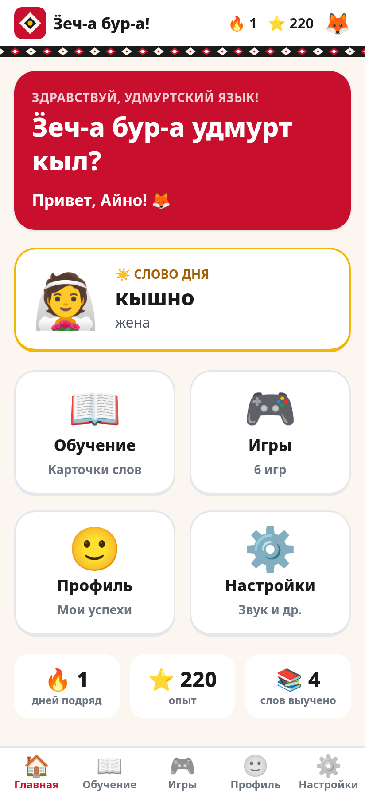
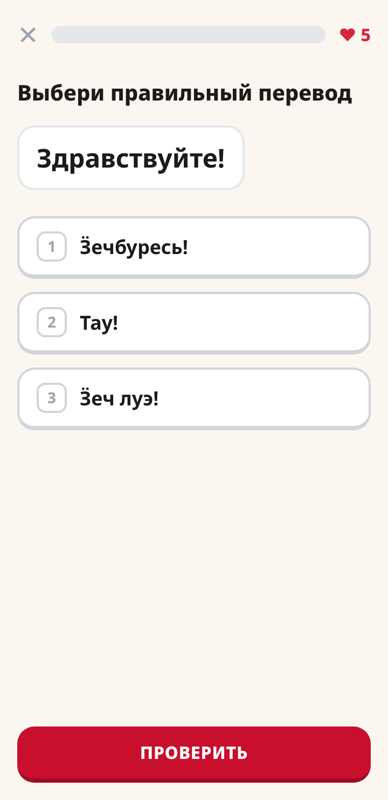
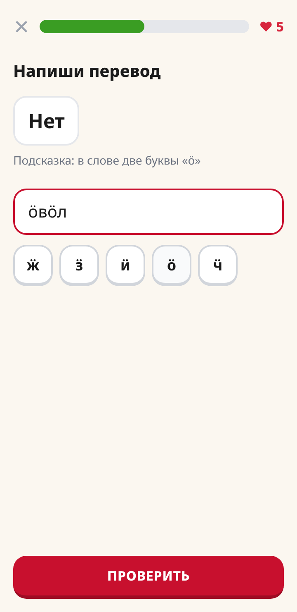
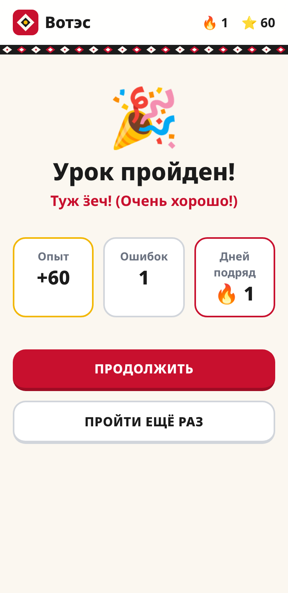

# Вотэс — учим удмуртский играя

Мобильная игра для детей в стиле Duolingo для изучения удмуртского языка.
Проект для хакатона «Удмуртский ИТ-класс „Вотэс“» (направление «Мобильная разработка»).

[](https://github.com/MarshMeg/hakaton-ipek-2026/actions/workflows/ci.yml)
· **[Скачать APK](https://github.com/MarshMeg/hakaton-ipek-2026/releases/latest/download/votes.apk)**
· **[План реализации](ROADMAP.md)**
· Сервер: https://hakaton.marshmeg.ru

<p>
  
  
  
  
</p>

## Что умеет
- **Карта курса**: разделы и уроки; следующий урок открывается после прохождения предыдущего.
- **4 типа упражнений**: выбор перевода, ввод с клавиатуры, сборка фразы из слов, сопоставление пар.
- **Удмуртские буквы Ӝ Ӟ Ӥ Ӧ Ӵ**: экранная панель для ввода. Если вместо «ӧ» написать «о», ответ
  засчитывается как «почти верно», и игра показывает правильное написание.
- **Игровая механика**: 5 сердечек, опыт (XP), серия дней подряд, повтор ошибок в конце урока,
  мгновенная обратная связь.
- **Без регистрации**: играть можно сразу как гость, а регистрация сохраняет прогресс.
- **Админка** `/admin`: слова, уроки, аудио и картинки редактируются без программиста.

## Стек
| Слой | Технологии |
|---|---|
| Backend | Python 3.12 (uv), Django 5.2, gunicorn, whitenoise |
| Frontend | Django Templates, HTMX, Alpine.js, Tailwind CSS (брендбук в `backend/tailwind.config.js`) |
| Данные | PostgreSQL 16, MinIO (S3) для аудио и картинок |
| Мобильное приложение | Flutter (Dart) + `webview_flutter` |
| Инфраструктура | mise (версии инструментов и задачи), Docker Compose, GitHub Actions (тесты, линтер, сборка APK) |

Подробнее: [docs/architecture.md](docs/architecture.md).

## Быстрый запуск (Docker)
Нужен только Docker.

```bash
cp .env.example .env          # необязательно: без .env используются значения по умолчанию
docker compose up --build
```

| Адрес | Что там |
|---|---|
| http://localhost:8000 | игра (откройте в мобильном режиме браузера) |
| http://localhost:8000/admin | админка контента (логин `admin` / пароль `admin12345`) |
| http://localhost:9001 | консоль MinIO (`minioadmin` / `minioadmin`) |

При первом старте автоматически применяются миграции, загружается стартовый курс из
`backend/seeds/content.yaml` и создаётся администратор.

## Запуск без Docker (для разработки)
Инструменты ставятся через [mise](https://mise.jdx.dev), подробная инструкция — [LOCAL_SETUP.md](LOCAL_SETUP.md).
```bash
cd backend
mise trust && mise install   # uv + Tailwind CLI
mise run setup               # uv sync (Python 3.12, зависимости), миграции, стартовый курс
mise run dev                 # http://localhost:8000
```
Без переменной `DATABASE_URL` используется SQLite, без `USE_S3=1` медиа хранятся в `backend/media/`.

## Android-приложение
**Скачать APK:** https://github.com/MarshMeg/hakaton-ipek-2026/releases/latest/download/votes.apk

APK собирается в GitHub Actions при изменениях в `mobile/` на ветке `main` (или вручную:
Actions → Android → Run workflow) и публикуется в
[Releases](https://github.com/MarshMeg/hakaton-ipek-2026/releases). Приложение открывает сервер
`https://hakaton.marshmeg.ru`; адрес можно поменять в самом приложении (экран «Нет связи с сервером»).

**Сборка с выбором адреса** — для проверки на своём сервере, при каждом запуске спрашивает, какой
адрес открыть: https://github.com/MarshMeg/hakaton-ipek-2026/releases/latest/download/votes-ask.apk
(локально: `mise run apk:ask`).

Сборка вручную (Flutter и Java ставит mise, Android SDK — Android Studio), см. [LOCAL_SETUP.md](LOCAL_SETUP.md):
```bash
cd mobile
mise trust && mise install
mise run setup   # flutter create + pub get
mise run dev     # эмулятор против локального сервера http://10.0.2.2:8000
```

## Тесты и линтер
```bash
cd backend
mise run test
mise run lint
```

## Изменение стилей
CSS собирается standalone-версией Tailwind 3.4.17 (ставится через mise, Node.js не нужен),
готовый `static/css/app.css` лежит в репозитории:
```bash
cd backend
mise run css         # или mise run css:watch
```

## Контент
Курс описывается в `backend/seeds/content.yaml` (формат описан в начале файла) и загружается командой
`mise run seed`. Также его можно редактировать в админке.

> ⚠️ Стартовые слова и фразы демонстрационные. Перед сдачей их нужно сверить с носителем языка
> или с материалами кейса.

## План и статус
Сейчас готов рабочий каркас: 4 типа упражнений, игровая механика, админка, Docker и APK.
Дальше работаем по этапам хакатона: разбор кейса (15.10), MVP, стабилизация, сдача до 26.10 и
очный этап 06.11. Подробный план с приоритетами и чек-листами: **[ROADMAP.md](ROADMAP.md)**.

## Команда
| Участник | Роль |
|---|---|
| _имя_ | проектный менеджер / разработчик |
| _имя_ | разработчик (бэкенд) |
| _имя_ | разработчик (мобильное приложение) |
| _имя_ | дизайнер / аналитик |

## Как вносить изменения
1. Создайте ветку от `main`, сделайте изменения и откройте Pull Request.
2. CI должен быть зелёным: ruff, pytest, сборка APK.
3. Если изменения затронули `mobile/`, после merge в `main` CI сам публикует новый APK в Releases.

## Структура
```
backend/            Django-проект
  config/           настройки, URL
  courses/          контент курса: модели, админка, команда seed
  learning/         игра: экраны урока, проверка ответов, логика урока
  accounts/         игроки: гостевой режим, регистрация, XP и стрик
  templates/        HTML-шаблоны (HTMX + Alpine.js)
  static/           CSS, шрифты с удмуртскими буквами, htmx/alpine
  seeds/            стартовый контент
  tests/            pytest
mobile/             Flutter-приложение (WebView)
docs/               архитектура, скриншоты
ROADMAP.md          план дальнейшей реализации
LOCAL_SETUP.md      настройка окружения через mise (инструкция и для Claude Code)
mise.toml           задачи Docker; инструменты — в backend/mise.toml и mobile/mise.toml
```
